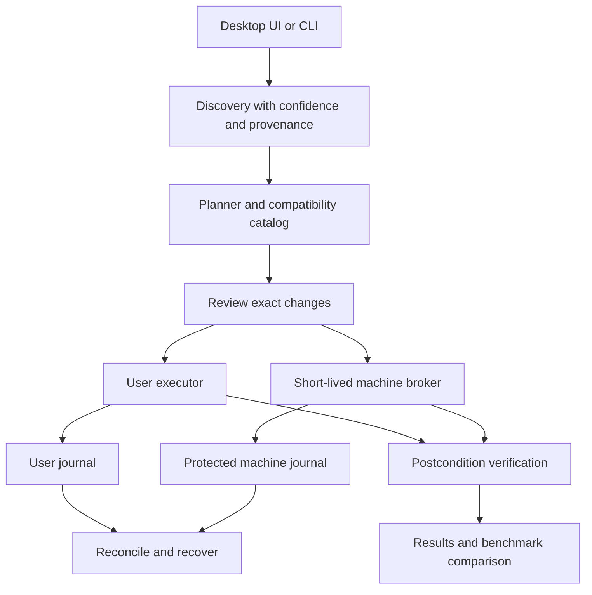

# Windows 11 Optimizer: complete revamp plan

**Decision date:** 2026-10-04, Europe/Budapest. **Status:** audit and design deliverable; implementation has not started. **Audience:** personal Windows 11 PCs for gaming, everyday work, and laptop use.

## 1. Recommended direction

Rebuild this project as a Windows assessment, settings, maintenance, and performance toolkit with a native interface, a reusable execution engine, and recoverable individual actions. Preserve the useful intent of the existing script, but replace its execution model and reconsider every default.

The product should be comprehensive in what it can diagnose and help improve. Its normal launch should assess the PC, explain concrete opportunities, and prepare a reviewable proposal. Installing utilities, removing applications, changing network configuration, and running repairs are separate selected operations. Confidence comes from verified outcomes, qualified compatibility, and explicit recovery limits.

The first release should provide a small, complete assess/apply/verify/undo experience. The later milestones deliberately broaden it into a substantial toolkit. A large catalog is worthwhile only when each entry explains its purpose and behaves reliably.

Read the companion [audit](AUDIT.md), [performance research](research/WINDOWS-PERFORMANCE.md), [quality-of-life catalog](research/WINDOWS-QOL.md), [public-tool evaluation](research/PUBLIC-TOOLS.md), and [research reconciliation](research/RESEARCH-RECONCILIATION.md). The four supplied reports remain preserved in the project root as research inputs. They do not authorize commands or establish that a claim has been verified.

## 2. Decisions that govern the revamp

| Decision | Selected approach | Reason and practical limit |
|---|---|---|
| Default launch | Assessment, then proposal | No surprise system changes; users can inspect incomplete inventory. |
| Product scope | Personal consumer PCs first | Managed devices are detected and restricted to assessment/guidance initially; no enterprise rollout platform in v1. |
| Runtime | C# on .NET 10 LTS | Suitable for typed Windows providers, native UI, and a small elevation boundary. PowerShell remains an optional adapter dependency. |
| Interface | WPF desktop shell with a CLI sharing the same core | Good fit for a Windows-only local tool; no web server, browser runtime, or always-running agent required. |
| Privileges | Unelevated UI and user actions; short-lived elevated broker for machine actions | Avoids changing the credentialed administrator's HKCU when a different user requests elevation. |
| Persistence | Per-principal journals plus protected machine journal; SQLite for durable events | Recovery is organized by action and privilege scope. The databases do not make Windows operations transactional. |
| Extensibility | Versioned data catalog with compiled, allowlisted providers | Imported profiles specify intent, never arbitrary executable commands or registry paths. |
| Third-party scripts | Optional, individually qualified adapters; Raphire first | A pinned dependency still requires scope review, postcondition checks, and honest recovery limitations. |
| Profiles | Everyday, Gaming, Laptop, Privacy, Minimal Distraction; separate maintenance/tool selections | These prepare proposals. They cannot override explicit choices or combine conflicting owners of one setting. |
| Performance claims | Per-workload evidence | Configuration verification and measured speed improvement are different results. |
| Delivery | Read-only prototype → reversible vertical slice → broader catalog → lab-qualified release | No need to build every subsystem before getting a usable read-only product. |

.NET 10 is an active LTS release with support through November 14, 2028. Choose a patched SDK/runtime at implementation time; self-contained releases must ship runtime security updates themselves. These are framework choices, not proof of application reliability. [Microsoft .NET support policy](https://dotnet.microsoft.com/en-us/platform/support/policy/dotnet-core).

## 3. Product experience and feature breadth

### 3.1 Main screens

| Screen | What the user sees and can do |
|---|---|
| Overview | Windows support status, storage pressure, startup observations, selected profile, pending restart/recovery, and evidence-backed opportunities. No arbitrary optimization percentage. |
| Performance | Boot/login and background workload review; gaming presentation; memory/commit pressure; power, thermal, storage, network and sleep diagnostics. Start short assessments or explicitly selected longer recordings. |
| Windows preferences | Explorer, search, taskbar, notifications, window management, accessibility and privacy settings with current values and scope. |
| Apps and startup | Installed packages, publisher, dependencies where known, affected users, startup entries, application-data implications, and exact selected removals. |
| Maintenance | Storage analysis, cleanup selection, Windows maintenance status, guided repair, update/restart settings, recovery readiness. |
| Tools | Searchable optional utility catalog with purpose, publisher, license, acquisition source and background footprint. |
| Review | Each proposed change, why it was suggested, before/after value, affected account, expected benefit class, dependencies, tradeoffs and undo grade. |
| Activity and results | Planned, already configured, skipped, blocked, changed and verified, awaiting restart, failed, or uncertain. Expandable logs and performance evidence. |
| Recovery | Runs and individually recoverable actions; compare original/applied/current state; restore eligible changes or explain why recovery needs manual action. |

The interface should offer a short guided route and an expandable expert view. Advanced detail belongs near the change it explains. Keyboard navigation, screen readers, high contrast, text scaling, and 100–200% DPI must work across the complete workflow. Long operations keep navigation responsive and show their actual stage rather than an invented completion percentage.

### 3.2 Capability map

The detailed catalogs give sources and applicability. This map fixes the intended breadth and staging.

| Capability group | Planned features | Automation boundary |
|---|---|---|
| Startup and background work | Startup inventory; ownership and digital-signature context; sampled CPU/disk/memory activity; impact ranking; selected app startup changes; Autoruns handoff | Never bulk-disable unfamiliar tasks/services. Driver, security, sync and peripheral software need contextual review. |
| Gaming | Refresh-rate mismatch detection; windowed-game optimization; graphics preference guidance; VRR/HDR review; per-game capture/overlay review; Game Mode checks; frame-time comparisons | Preserve Game Bar/Xbox dependencies, including hardware-specific scheduling needs. HAGS and overlay changes require per-system evaluation. |
| CPU, power and thermals | AC/battery awareness; current power-mode inventory; throttling investigation; vendor driver guidance; measured power-mode experiments | No blanket core unparking, CPU affinity, forced maximum plan, overclocking or firmware writes. |
| Memory | Commit/pagefile report; memory-pressure sampling; hard-fault context; high-consumption application review | Preserve adaptive memory management; no routine cache flush or RAM-capacity-based compression/pagefile recipe. |
| Storage | Free-space and large-folder analysis; cleanup preview; Windows Optimize Drives/TRIM status; Storage Sense configuration; component-store analysis | Retain Windows maintenance. No manual WinSxS deletion, global cache purge, or file deletion disguised as fully reversible. |
| Network | Selected adapter inventory; DNS mode and route context; resolver timing; idle/loaded latency tests; VPN awareness; optional selected DNS changes | No default DNS replacement. Router congestion remediation is guided; NIC experiments require measured need. |
| Sleep and battery | Battery report, SleepStudy guidance, sleep blockers, resume reliability, laptop runtime comparison | No unsupported S0/S3 conversion, blanket hibernation removal, or firmware assumptions from chassis alone. |
| Explorer and search | Extensions, navigation preferences, preview guidance, search scope, indexing status, optional Everything | File-search tools complement Windows Search; they do not establish that Outlook, Start or content indexing is unnecessary. |
| Desktop productivity | Taskbar/Start preferences, distraction reduction, notification controls, Snap/desktops, clipboard choices, selective PowerToys | Preserve accessibility and notifications the user needs. Cloud clipboard and account-linked features are explicit choices. |
| Privacy and AI | Review optional diagnostics, advertising/personalization, app permissions, activity/cloud features, Recall/Copilot controls where available | Distinguish edition policy support, feature presence and actual effect. App-camera permission is different from disabling Windows Hello hardware/services. |
| Apps | Per-package selection, current-user removal, dependency review, reinstall route and data-risk explanation | All-user and future-user provisioning are separate advanced scopes, deferred beyond first release. |
| Repairs and updates | Supported update guidance, active hours/restart preferences, health diagnosis and selected repair, result capture | Repairs are maintenance, not speed boosts. No automatic driver pack, global module installation or update blocking. |
| Optional utilities | PowerToys, Sysinternals, Everything, disk visualizer, uninstaller, PresentMon/CapFrameX and specialist diagnostics | Install selected tools only. Similar tools are alternatives; avoid redundant installs and persistent overhead. |
| Benchmark and recovery | Repeatable sessions, raw local results, comparisons, change history and action-level undo | No FPS promise from process count/free-RAM snapshots; recovery support is stated per resource. |

### 3.3 Profiles and preference resolution

Profiles are versioned suggestions. First launch always assesses. Selecting a profile creates a proposal that can contain already-correct, actionable, blocked, and informational entries.

| Profile | Proposed focus | Preserved by default |
|---|---|---|
| Everyday | Explorer clarity, distraction preferences, startup/storage review | Printing, search, security, sync, Bluetooth, accessibility, updates and automatic memory management |
| Gaming | Presentation and refresh checks, startup/overlay review, benchmark setup | Game Pass, controllers, Game Bar-dependent functionality, security and current network settings |
| Laptop | Battery/sleep diagnosis and power-aware suggestions | Modern Standby platform model, hibernation, adaptive CPU/GPU behavior |
| Privacy | Supported privacy controls, permission review and optional AI/cloud choices | Updates and security; location/Find My Device and account conveniences remain explicit decisions |
| Minimal Distraction | Notifications, taskbar clutter, tips and recommendations | Accessibility and user-selected alerts |

Resolve inputs in this order: explicit per-action choice → imported explicit preference → selected profile suggestion → preserve current state. Multiple explicit contradictory requests are an error, not a precedence contest. Dependencies can block a choice or request a new proposal; they cannot silently enable extra changes. `Keep` is an explicit instruction that contributes no mutation to that resource.

Remove legacy `Full` and `AssumeYes means maximum` semantics. A future noninteractive apply command requires a specific reviewed plan, matching catalog version, machine/account identity, nonexpired prerequisites and explicit risk selections. It cannot expand scope during execution. Reboot remains deferred unless separately selected.

## 4. Architecture and boundaries



### 4.1 Initial repository layout

This is the proposed future layout, not files claimed to exist now. Start with a few projects and split further only when responsibility justifies it.

```text
src/
  Optimizer.Core/          contracts, planner, profiles, state machine, journal interface
  Optimizer.Windows/       discovery and allowlisted Windows action providers
  Optimizer.App/           WPF interface; no elevated arbitrary execution
  Optimizer.Cli/           assessment, plan, apply, verify, recovery, export
  Optimizer.Broker/        short-lived elevated machine executor
catalog/
  actions/                versioned metadata referring to compiled provider IDs
  profiles/               intent, overrides and dependency declarations
  compatibility/          qualified builds, capabilities and known exceptions
  artifacts/              reviewed third-party identity and complete payload hashes
tests/
  unit/  contracts/  broker-security/  fault-injection/  integration/  accessibility/
lab/
  scenarios/              VM recipes, physical hardware matrix, performance protocol
docs/
  decisions/  recovery/  evidence/  development/
```

Keep compiled executables, approved catalogs and broker dependencies in a protected install location. User profiles and ordinary exports are untrusted input. Per-user data lives under LocalAppData with user-scoped permissions; machine state lives under a broker-created ProgramData directory with checked ownership/ACLs. A central overview may aggregate summaries, but a user-writable journal must never instruct the elevated broker to restore arbitrary privileged state.

### 4.2 Discovery model

Every detector returns `KnownPresent`, `KnownAbsent`, `Unknown`, `Unavailable`, or `NotApplicable`, together with timestamp, scope, source API, raw error category and confidence. A value has a typed unit. Empty output is not automatically absence.

Capture build plus update revision, edition, architecture, execution architecture, language, original-user identity, management indicators, feature presence, permissions, reboot state, and relevant resource configuration. Prefer stable APIs and identifiers. If only localized output is available, a parser must have language fixtures; otherwise return unavailable.

Low-cost detectors run first with bounded parallelism. Expensive disk scans, all-user inventory, downloads, traces and benchmarks are explicit additional assessments. The default assessment performs no optimization writes and no network activity; optimizer-owned logs/cache and unavoidable Windows observational side effects are outside a claim of literal zero disk writes. Partial results remain useful and clearly marked.

### 4.3 Planner

The planner binds stable action IDs and typed parameters to the actual discovered resources. It determines applicability, dependency order, conflicts, touched resources, privilege scope, restart requirements, estimated duration class and recovery grade.

Each resource has one owner in a plan, including resources touched indirectly by third-party adapters. For example, a native privacy action and a Raphire option cannot both own the same policy value. Unknown external side effects prevent that adapter from joining an exact-recovery bundle.

The plan includes schema/catalog versions, machine-local identity, initiating SID, creation time, precondition fingerprints, selected actions, explicit exclusions and artifact identities. Hash it to identify the reviewed bytes. A hash is neither a signature nor proof of consent. Revalidate its contents and all relevant preconditions when applying; stale inputs produce a new reviewable proposal.

### 4.4 Privileged execution

Use ordinary user execution for current-user preferences. The machine broker exposes only specific action IDs with compiled provider definitions and bounded parameters. It must not offer `RunCommand`, arbitrary registry paths, arbitrary executable paths, user-provided script blocks, or privileged recursive deletion roots.

Secure local IPC with explicit access control, session/client token checks, replay-resistant run binding and a carefully reviewed handoff. The elevated process independently resolves and displays the final machine scope it will execute, validates package integrity and every action's resource bounds, and rejects changed plans. Treat other processes running as the same user as a meaningful tampering risk; a pipe ACL or nonce alone does not prove human intent. Do not claim protection from an already-compromised administrator or kernel.

Launch privileged helpers with an explicit trusted executable path, working directory and constrained environment. Resolve module and helper dependencies from reviewed locations instead of inheriting user-writable PATH/PSModulePath or current-directory search. A pinned PowerShell host with profiles disabled does not by itself pin everything its script invokes.

No resident service, startup optimizer, remote API or automatic scheduled mutations in v1. If the original unelevated process disappears during alternate-credential elevation, user-scope work pauses instead of falling back to the administrator's profile. Microsoft's UAC guidance supports useful standard-user operation and scoped elevation; pipe permissions must be explicitly controlled. [UAC application design](https://learn.microsoft.com/en-us/windows/win32/uxguide/winenv-uac), [named-pipe security](https://learn.microsoft.com/en-us/windows/win32/ipc/named-pipe-security-and-access-rights).

## 5. Action, journal and recovery contract

### 5.1 Required action metadata

Each catalog entry requires: stable ID and version; purpose; benefit class (performance, usability, privacy, storage, repair); evidence URLs and review date; typed parameters; explicit supported compatibility records; prerequisites; original-user/machine scope; precise resource IDs; dependencies/conflicts; privilege; snapshot/apply/verify/recover provider IDs; side effects; safe cancellation/retry behavior; restart requirements; recovery grade; report privacy classification; tests and responsible maintainer.

**Worked specification, not an approved Windows implementation:**

```json
{
  "id": "explorer.show-file-extensions",
  "version": 1,
  "benefitClass": "Usability",
  "scope": "InitiatingUser",
  "provider": "ExplorerExtensionVisibility",
  "parameters": { "show": true },
  "compatibility": {
    "requiresQualificationRecord": true,
    "requiresCapability": "Explorer.ExtensionVisibility"
  },
  "selection": "SuggestedInEverydayProposal",
  "recovery": "CapturedConfiguration",
  "verification": ["ReadConfiguredValue", "CheckEffectiveShellBehavior"],
  "restart": "ProviderDeterminedShellRefresh",
  "securitySensitive": false
}
```

The provider's internal registry recipe, if chosen, must be lab-qualified. A documented Settings checkbox does not prove its backing registry key is a supported automation interface. Unknown builds do not inherit qualification via an open-ended minimum build number. The example deliberately does not authorize free-form paths or scripts from a profile.

### 5.2 Write sequence

1. Validate compatibility, authority, selected scope, pending recovery and prerequisites; acquire the mutation lock.
2. Re-read targeted state immediately before action. If it already meets the request, record `AlreadyConfigured` without writing.
3. Capture sufficient before-state, including value existence, type, ordered values and relevant mode distinctions.
4. Durably publish snapshots and commit `Prepared`; then commit an apply-intent event before invoking Windows.
5. Perform the bounded action. Keep native output and error details separate from status.
6. Read the postcondition through a fresh observation. Record verified configuration, awaiting restart, failure, or indeterminate result.
7. On failure, stop dependent work. Reconcile the touched resource before deciding whether bounded recovery is appropriate. Do not automatically continue an entire destructive batch.
8. Export results from durable events, including interrupted/partial runs.

Use `Proposed`, `Blocked`, `AlreadyConfigured`, `Prepared`, `Applying`, `Verifying`, `Verified`, `AwaitingRestart`, `Failed`, `Indeterminate`, `Recovering`, `Recovered`, and `RecoveryConflict`. Store reasons separately instead of encoding every cause into a new status.

### 5.3 Durability and crash handling

SQLite is the selected journal, with WAL, explicit synchronous durability policy, verified settings, schema migrations and tested recovery. Before-state blobs must be durably written and validated before a committed record references them. Snapshot database backups must include committed WAL state using supported backup procedures. No unbounded secret-bearing stdout in the database.

FULL synchronization in WAL mode adds a sync for each transaction; it is not an atomic transaction with the registry, service manager, filesystem or AppX. Storage hardware may also fail. Test disk-full, access loss, corrupted snapshots, process death and reboot at the write boundaries. If journal preparation fails, do not begin the matching action. [SQLite synchronous behavior](https://www.sqlite.org/pragma.html#pragma_synchronous).

A restart after `Applying` means outcome unknown until observed. Equality with the intended configuration permits classifying the observed result, but cannot establish that no other actor changed it. Record that distinction. A service or installer may continue after its launching process exits; timeouts therefore do not imply rollback.

### 5.4 Recovery grades

| Grade | Promise | Examples and limits |
|---|---|---|
| Captured configuration | Restore the specific captured configuration when applicable and no detected conflict | Registry value/type/absence; task enabled state. Does not restore all runtime behavior, user work, external changes or arbitrary OS state. |
| Reconstructable | Restore equivalent managed configuration | Recreate an optimizer-owned plan from saved settings. Original GUID/runtime history may not be meaningful or recoverable. |
| Best effort | Attempt documented recovery with unmet prerequisites reported | App reinstall can depend on Store/network/package availability and cannot promise deleted app data. |
| Irreversible | No automatic undo promise | Permanent deletion, some servicing operations and application-data removal. These are excluded from ordinary profile batches. |

**Example:** a registry value originally existed as a string `"400"`; the selected action writes `"100"`. Capture type and existence before writing. During undo, compare current state with the observed applied state. If it differs, show original/applied/current values and stop automatic recovery. If it matches, recheck and restore the original string. If originally absent, remove only the value this action created; never recursively delete a shared key with new content.

This is a best-effort divergence guard. It is not atomic compare-and-swap and cannot detect an external change away and back to the same value. Journal sequencing coordinates this application, not all Windows actors.

Restore points are supplementary. If a chosen operation explicitly requires a restore point and creation fails, block it. If a reversible action relies on its own valid snapshot and a restore point was optional, explain the failure before proceeding under the reviewed policy. Never call a restore point a backup of deleted personal/app data.

### 5.5 Provider-specific requirements

| Provider | Required capture and verification |
|---|---|
| Registry | Hive/user SID, registry view, value type, existence and data; detect policy ownership; avoid deleting unrelated key content. |
| Service | Only the properties actually changed, including delayed-auto-start where relevant; runtime status separately; dependencies and protected features. Do not promise to recreate process sessions or credentials. |
| Scheduled task | Exact stable path, existence, enabled state; capture definition only if modifying it. Do not delete/recreate tasks merely to restore an enabled flag. |
| DNS | Stable interface identity, IPv4/IPv6 configuration, automatic/static mode, address order and relevant resolver policy; no default all-adapter writes. Interface index alone is insufficient. |
| Power | Original active GUID, only changed AC/DC values, ownership of newly created plans; remove only owned unused plans during recovery. |
| AppX | Exact package/family/version/user and intended provisioning scope; dependency/usage review; removal results per package; distinguish configuration restoration from data recovery. |
| Files | Fixed allowed roots, stable file identity, metadata/reparse checks, review manifest, age/active-use policy, explicit retention/quarantine or irreversible label. An old preview never grants permission to delete newly appeared files. |
| Servicing | Documented tool outcome, logs and reboot state; no generic forced termination, blind retry or promise of atomic rollback. |
| External adapter | Complete reviewed payload identity, explicit options and target, touched-resource inventory, side-effect limits, actual postconditions; opaque portions retain weaker recovery grades. |

Network changes are advanced operations with a preview and saved baseline. Automatic and static DNS are distinct; restoring old server addresses is not equivalent to restoring DHCP. Add connectivity tests as diagnostics, not as proof that every VPN, split-DNS or LAN name works.

## 6. Third-party integration policy

Adopt Raphire/Win11Debloat as the first optional adapter candidate. Use native providers for small well-understood settings because they give the best per-action visibility and recovery. Use WinUtil and Sophia primarily as reviewed references; qualify selected adapters later only where they add enough value. Do not stack their broad presets.

The complete comparison and verified candidate identities are in [PUBLIC-TOOLS.md](research/PUBLIC-TOOLS.md). Release identity is research evidence, not automatic approval to execute it. No third-party payload was installed or integrated during this audit.

An approved adapter needs all of the following:

1. Exact upstream origin, full commit/release identity, archive and per-file hashes, license notices, reviewed dependencies and runtime/architecture requirements.
2. Documented explicit option allowlist and application target. For Raphire, current-user intent must never depend on an all-user default.
3. Review of nested downloads, update checks, local configuration autodiscovery, dynamic imports, prompts, profile defaults and additional processes.
4. Safe extraction without path traversal, links or unexpected payloads, staged into protected storage; revalidate the actual bytes before execution.
5. A declared resource/side-effect contract and overlap detection against native actions.
6. Independent verification of selected outcomes, with incomplete or opaque outcomes reported honestly.
7. A tested failure/recovery plan. Existing upstream backup features supplement, rather than replace, our action records.

Public availability is not a redistribution license. For proprietary utilities use their approved acquisition route or open their official page. The install catalog must use exact package identity and explicit source, with no fallback to a fuzzy display-name search. Package-manager hashes are part of validation, not a reason to skip publisher review. Unknown or changed artifacts remain blocked until reviewed.

Do not add custom ISO builders, automatic driver bundles, security-disabling presets, remote download-and-evaluate launchers, BIOS overclocking or arbitrary community scripts to the normal product. Keep developer experiments in a separate lab rather than exposing unsupported boot tweaks as another attractive checkbox.

## 7. Performance measurement and confidence

The tool should distinguish four statements: a setting is documented; a change was applied; its effective behavior was verified; a measurable benefit was observed. Only the last supports a performance improvement claim.

Capture OS revision, driver versions, hardware class, power/battery state, display configuration, app/game build, background activity, workload and measurement-tool version. Ask for the symptom before starting a diagnostic session. Prefer low-overhead measurements initially and offer ETW/WPR, PresentMon or specialist diagnostics when needed.

| Goal | Primary measure | Guardrails |
|---|---|---|
| Faster startup | Consistent boot/login-to-usable criterion, with Fast Startup and full reboot separated | Same startup apps/network state; several trials; no artificial cache flush presented as everyday use |
| Faster launches | Warm and cold launch timing of selected apps | Same dataset; distinguish caching benefit from changed application state |
| Smoother gaming | Frame-time distribution, stutters, percentile FPS with declared calculation | Same scene/settings; rendering performance is not end-to-end input latency |
| Lower network delay | Idle and loaded RTT/jitter/loss plus throughput | Resolver lookup time is separate from established-game traffic; repeat different times/routes |
| Better memory behavior | Peak commit/headroom, hard faults with I/O context, responsiveness under load | Free RAM alone is not a benefit; preserve crash-dump requirements |
| Better laptop behavior | Runtime/drain under a controlled task, sleep/resume reliability | Battery health, brightness, radio state and temperature controlled |
| More free space | Bytes actually reclaimed after selected cleanup | Account for backups/quarantine; never imply a proportional FPS gain |

Initial lab protocol: repeated unchanged baseline runs to estimate noise, warm-up, at least five paired A/B runs for short tasks where feasible, counterbalanced order, raw results, median and spread, and a predefined meaningful-effect threshold for each scenario. Longer battery/boot tests use a justified scenario-specific sample count. If the result lies within baseline variation, label it inconclusive. Evaluate power, temperature, feature and security regressions alongside the target metric.

Catalog evidence levels: **documented mechanism**, **lab-qualified benefit for specified configurations**, **user-measured benefit**, **preference**, and **unproven hypothesis**. Do not collapse these into a single numeric confidence score. Review dates and known exceptions travel with the action.

## 8. Compatibility and release policy

Compatibility is per action/provider, not a blanket promise that every Windows 11 installation works. Current-user UI features, policy keys, optional components and third-party scripts have different boundaries.

As checked on October 4, 2026, Microsoft's release table lists 26H2/build 26300, 25H2/build 26200 and the distinct 26H1/build 28000 branch. 24H2 Home/Pro support ends October 13, 2026. The higher numeric 26H1 build is a concrete reason to avoid a simple `build >= minimum` rule. [Windows release information](https://learn.microsoft.com/en-us/windows/release-health/windows11-release-information).

| Lane | Planned support treatment |
|---|---|
| 25H2 Home/Pro x64 | Initial stable lab baseline for the complete first-release workflow |
| 26H2 Home/Pro x64 | Concurrent current-release qualification; ship only actions that pass the same gates |
| 24H2 consumer x64 | Assessment and migration guidance; mutation qualification only while supported and worth maintaining |
| Arm64, including relevant 26H1 hardware | Native assessment and separate provider/adapter qualification; no claim of full parity until tested |
| Enterprise/Education, domain/MDM-managed, LTSC | Assessment and ownership detection initially; avoid overwriting management policy |
| Insider/future/modified Windows | Assessment where possible; unknown mutation recipes blocked, no build-spoof workaround |

Use VM tests for registry, identity, failure handling and recovery; use real hardware for GPU, audio, storage, battery, drivers, networking and sleep. Initial physical coverage should include Intel hybrid, AMD including an X3D case, an S0 laptop and a discrete-GPU desktop; expand Arm64 only with appropriate hardware.

Pairwise scenarios cover 8/16/32/64+ GB RAM; SATA/NVMe/multiple disks; integrated/discrete/hybrid GPUs; AC/battery; S3/S0; Ethernet/Wi-Fi/VPN/virtual adapters; physical/PDF-only/network printers; BitLocker; Hello; controllers/headsets; single/multi-user; local/Microsoft accounts; separate-admin elevation; English and Hungarian Windows; no PS7; offline; low disk; pending reboot; protection or policy restrictions. Do not bypass WDAC/AppLocker or security policy to make an adapter run.

## 9. Delivery roadmap and acceptance gates

Effort sizes are relative (S/M/L/XL), not calendar promises. Each gate produces a usable reviewed artifact. Estimates can be refined after the first vertical slice.

| Milestone | Work packages and dependencies | Acceptance gate | Size |
|---|---|---|---|
| M0 — Baseline and decisions | Preserve legacy source/report hashes; establish source control during implementation; record threat model, schemas, exclusions, compatibility and licensing policy | Audit findings trace to backlog; original reports cannot be mistaken for proof of speed; no accidental legacy apply path | S |
| M1 — Assessment prototype | Core typed discovery, confidence/error states, redacted export, thin UI/CLI; depends on M0 | Nonadmin useful assessment without UAC or optimization writes; failed inventory visible; offline route works; exact target/user displayed | M |
| M2 — Reversible vertical slice | Plan/review, user registry provider, journal, verify/recover, stale-plan and divergence handling; depends on M1 | A few current-user preferences complete apply/verify/undo; absent/wrong-type values handled; crash and disk-full tests; second apply is no-op | L |
| M3 — Machine execution boundary | Short-lived broker, trusted catalog/IPC, locks, bounded native runner, protected journal, restart reconciliation; depends on M2 | Alternate-admin identity tests; arbitrary requests/tampered plans rejected; every machine write preceded by snapshot; interrupted actions reconcile | L |
| M4 — Everyday and QoL release | Qualified preference catalog, profiles, accessibility, privacy export and recovery UX; depends on M2/M3 as relevant | Everyday/Minimal Distraction end-to-end flows; every action has evidence/scope/undo; no known high-severity correctness defects | L |
| M5 — Apps, maintenance and tools | Current-user package review/removal, conservative cleanup, health/repair separation, exact tool installs, pinned Raphire pilot; depends on M3/M4 | Data-risk previews; AppX per-package results; containment tests; payload tampering rejected; opaque outcomes never called fully reversible | XL |
| M6 — Performance and gaming | Baseline sessions, frame-time/launch measurements, targeted startup/background findings, power/network/sleep diagnostics, per-game selections; depends on M4 and qualified tools | Repeatable results with noise reporting; representative physical tests; no security/feature regression to obtain claimed gains | XL |
| M7 — Broader compatibility and release | Arm64 as qualified, catalog update process, code signing, packaging, recovery docs, migration tooling and pilot testing | Release matrix published; reproducible package manifest; update/recovery tests; canary evidence and critical findings resolved | L |

### 9.1 Initial implementable backlog

| ID | Requirement | Milestone | Definition of done |
|---|---|---|---|
| CORE-01 | Explicit settings override profiles | M1 | Full-equivalent profile cannot rewrite Keep DNS or a false health-check option; conflict tests pass. |
| CORE-02 | Typed inventory with Unknown | M1 | Missing provider, denied query and empty successful result remain distinguishable. |
| CORE-03 | Declarative metadata validation | M1 | Invalid IDs/types/owners/dependencies, cyclic graphs and unknown catalog versions rejected. |
| CORE-04 | Plan binding and stale checks | M2 | Changing user, build, source catalog or precondition invalidates relevant apply permission. |
| REC-01 | Durable before-state and events | M2 | Failure to commit Prepared prevents mutation; interrupted events remain inspectable. |
| REC-02 | Action-level recovery | M2 | Exact captured fields restored when eligible; external differences block automatic overwrite. |
| EXEC-01 | Original-user scope | M2/M3 | Alternate-admin elevation does not change that admin's user preferences. |
| EXEC-02 | Native runner and semantic outcomes | M3 | Structured args; output limits; command-specific exit handling; no generic kill/retry policy for servicing. |
| EXEC-03 | Single mutation/recovery writer | M3 | A second run gets a clear busy/recovery-required result; stale owner triggers reconciliation. |
| SEC-01 | Broker action/resource allowlist | M3 | Tampered IDs/paths/parameters and user-journal injection cannot cause arbitrary privileged writes. |
| UX-01 | Honest preview and status | M4 | Explain benefit class, affected users, tradeoff and recovery; AlreadyConfigured distinct from Changed. |
| UX-02 | Accessibility and localization | M4 | Full keyboard/screen-reader review and undo; no clipped text; non-English detector fixtures. |
| QOL-01 | First preference catalog | M4 | Explorer clarity and selected supported distraction settings; each recipe individually qualified. |
| APP-01 | Current-user removal | M5 | Package/dependency/data scope shown; no implicit AllUsers/provisioning and no absent-package Applied. |
| DISK-01 | Cleanup boundary | M5 | Manifest exactness, late-created-file exclusion, reparse/identity tests, honest retention and errors. |
| EXT-01 | Artifact provenance | M5 | Complete payload lock and notices; no mutable launcher; mismatch blocks before execution. |
| EXT-02 | Win11Debloat limited adapter | M5 | Runtime and explicit target tested; only selected reviewed options; overlaps and side effects reported. |
| PERF-01 | Measurement sessions | M6 | Raw sample provenance, repeated baseline/A-B comparison and inconclusive result class. |
| PERF-02 | Targeted recommendations | M6 | Recommendation tied to observed bottleneck or user preference, with qualified applicability. |
| REL-01 | Signed packaging and catalog maintenance | M7 | Artifact inventory, release notes, checksums, dependency/license review and migration tests. |

### 9.2 Mandatory test gates

- Intent: default no apply; Keep means Keep; explicit false stays false; no auto-expanded removal/install scope.
- Error truthfulness: denied write, native failure, absent target, unsupported policy and successful command with unchanged state all produce distinct accurate outcomes.
- Recovery: value absent/type mismatch, half-completed multi-resource action, corrupt/missing snapshot, journal full, process death before/after each write, failed undo, outside changes and abandoned runs.
- Privilege: original-user SID, different admin credentials, trusted install-path enforcement, replay/tampered plan, malicious imported profile, IPC peer validation and no arbitrary command path.
- Files/artifacts: traversal, reparse point, source substitution, incomplete archive, changed bytes between validation and use, nested download and oversized log handling.
- Functional regression: security provider/firewall/UAC/BitLocker state preserved; Windows Update available; Store/App Installer; search; Print to PDF; Xbox/controller; Bluetooth/Hello; audio; sleep/resume and VPN checks according to selected features.
- Restart safety: preserve the opportunity to save work and cancel. Do not use a timed shutdown whose positive timeout silently implies force-closing apps; check native/API outcome and verify after the next boot. Microsoft's [shutdown reference](https://learn.microsoft.com/en-us/windows-server/administration/windows-commands/shutdown) documents this legacy trap.
- Dependency resolution: a same-name executable or module planted in a user-writable search path must not become an elevated helper dependency.
- Repeatability: identical second run does not duplicate plans or rewrite matching state; dry-run uses discovery/planning without entering mutation providers.
- Usability: user can understand a blocked action, cancel safely, export a redacted report, find an interrupted run and attempt appropriate recovery.

Hardware/VM tests are proposed release work. This audit did not run them and does not certify the current script.

## 10. Migration from the existing project

Preserve the legacy script, guide, supplied research and existing reports with hashes before implementation. The current folder has no Git repository; initialize source control at the implementation milestone, with existing reports and raw traces private by default. Do not publish machine names, account paths, MAC addresses, command lines or other identifiers from old reports.

Move the old workflow to a clearly labeled legacy location when the new entry point is ready. Do not silently reinterpret an old `-AssumeYes` call as permission for a new catalog. A compatibility launcher should explain retired semantics and prepare a plan, not run the unsafe legacy pipeline. Rewrite README examples only when the replacement actually exists.

For PCs previously changed by the old script, provide **assessment of current configuration and known legacy markers**, not “restore original defaults.” Old reports do not preserve enough prior state to reconstruct it. Offer supported recommended settings with user review and create a new baseline before any new writes. Do not run the old script merely to compare plans; use its static action map and fixtures.

Disposition of major legacy behaviors:

| Legacy area | Revamp treatment |
|---|---|
| Useful inventory/reports | Retain requirements; rewrite confidence, privacy, durability and status semantics |
| Small user preferences/privacy | Port individually after recipe/edition/effect qualification |
| Services/tasks | Remove bulk disables; retain inventory and narrowly justified selected actions later |
| Everything → disable WSearch | Remove coupling; keep both independently useful |
| Ultimate Performance/core unparking | Preserve current plan; measured opt-in power changes with owned-plan recovery |
| Fast Startup/hibernation | Separate preferences and diagnose sleep/boot tradeoffs |
| Modern Standby override/BCDEdit timer tweaks | Exclude from consumer catalog |
| Memory compression/fixed pagefile | Remove automatic recipes; preserve current adaptive configuration and diagnose pressure |
| DNS/NIC/QoS/Nagle | Keep current DNS; explicit per-adapter DNS later; NIC lab experiments; exclude bandwidth-myth tweak |
| AppX all users/provisioning | Replace with selected current-user workflow first; advanced scopes separate and deferred |
| Temp/component cleanup | New bounded previewed cleanup; servicing separate; ResetBase excluded from normal catalog |
| Twelve-tool bulk install | Selected purpose-based catalog; diagnostics often available without permanent installation |
| DISM/SFC/Windows Update | Separate diagnosis/maintenance, explicit repair; avoid global PSWindowsUpdate dependency |
| Hosts blocking | Exclude generic domain blocklist from profiles; prefer supported privacy controls |
| Reboot and final report | Durable results first; deferred restart with later verification |

## 11. Operational quality, distribution and maintenance

Do not add an always-running booster, scheduled RAM cleanup or resident telemetry by default. After work is complete and the app closes, its own processes should exit. Closing the window during a selected operation must explain whether Windows is still finishing work and retain its recovery status; it cannot promise to stop service-owned work immediately. Initial engineering budgets are targets to measure: interactive shell ready within roughly two seconds on a reference SSD system; default assessment within roughly thirty seconds with partial results; long scans/traces explicitly selected; cancellation acknowledged promptly even when Windows must finish an in-flight action.

Keep detailed logs locally, redact export by default, never collect recovery keys, credentials or full document contents. Traces may contain sensitive paths/process activity; label their contents before export. Proposed retention: ordinary diagnostic logs 30 days; recovery snapshots retained while undo is advertised. Removing snapshots must explicitly expire that recovery option, and unresolved runs must not be silently garbage-collected.

Ship signed binaries and a signed release/catalog manifest, dependency inventory and notices, checksums, change history, compatibility evidence and recovery instructions. Choose an OS-supported installation path/format after testing broker elevation, uninstall and update behavior. Test preserving recovery data across upgrade/downgrade; an older client cannot reinterpret a newer journal it does not understand.

Catalog updates undergo source diff review, recipe qualification, license/runtime review, regression tests and staged release. Reassess a recipe after OS feature changes. If a source is offline or an action is unqualified, assessment still works and the affected action explains the limitation. Updates never silently apply a new profile.

## 12. Remaining uncertainties and completion criteria

Decisions still requiring implementation evidence: exact supported automation mechanism for each preference; broker handoff security details; signing/distribution provisioning; journal encryption/key lifecycle if sensitive blobs are later introduced; reliable per-build package dependencies; Arm64 adapter availability; physical lab access; servicing cancellation behavior; repeatable benchmark workloads and thresholds. These are backlog gates, not reasons to pretend everything is already supported.

The design is ready to guide implementation when the team can trace each selected feature to its provider, compatibility, evidence and recovery contract. The software is ready for broad use only after the milestone gates pass on the advertised matrix, high-severity findings are resolved, measured claims are reproducible, and representative users can preview, apply, inspect failures and recover without guessing.

This deliverable completes the requested audit-and-plan stage. It does not claim an implemented revamp, measured speedup, or risk-free Windows modification.
